# Verified Course Material Studio

**Verified Course Material Studio** is an automated curriculum and slide generation studio tailored exclusively for professors who teach **CODING subjects**. It transforms programming concepts into minimal-text, beautifully branded PowerPoint presentations whose safe zones, collision avoidance, and typography are mathematically verified, with every code snippet, exercise, quiz question, and mistake prediction verified by execution in isolated runtime sandboxes.

---

## Architecture Diagram

```mermaid
graph TD
    User["Professor / Instructor"] --> Frontend["React 19 + Vite + Tailwind UI"]
    
    subgraph UI_Stepper["Sequential Studio Stepper"]
        S1["1. Inputs"] --> S2["2. Template Preview"]
        S2 --> S3["3. Deck Preview"]
        S3 --> S4["4. Verification Core"]
        S4 --> S5["5. Professor Approval"]
        S5 --> S6["6. Materials Studio"]
        S6 --> S7["7. Export Center"]
    end
    
    Frontend --> FastAPIServer["FastAPI Backend (Port 8000)"]
    
    subgraph Core_Engines["Studio Engine Pipeline"]
        FastAPIServer --> TopicValidator["Topic Validator (Rejects Non-Coding)"]
        FastAPIServer --> LLMGenerator["Ollama LLM (qwen2.5 / phi3)"]
        FastAPIServer --> TemplateRegistry["Template Registry (VIT / DPU)"]
        FastAPIServer --> LayoutEngine["Collision & Safe-Zone Layout Engine"]
        FastAPIServer --> PPTXBuilder["python-pptx + Pygments Highlighting"]
        FastAPIServer --> SlideRenderer["1080p Slide Visualizer"]
    end
    
    subgraph Verification_Pipeline["Verification & Sandbox Layer"]
        LayoutEngine --> VerifierCoordinator["Verification Coordinator"]
        VerifierCoordinator --> SandboxEngine["Docker Sandbox (Network None, Read-Only FS)"]
        SandboxEngine --> RuntimeRegistry["10 Pinned Language Runtimes"]
        RuntimeRegistry --> SelfHealer["AST Analyzer & Healing Loop"]
    end
    
    subgraph Post_Approval_Studio["Phase 3: Supporting Materials Studio (Post-Approval Only)"]
        FastAPIServer --> ApprovalGate{"Professor Approved?"}
        ApprovalGate -- Yes --> NotesGen["Student Notes (150-250w) & Prof Notes"]
        ApprovalGate -- Yes --> MistakePredictor["Student Mistake Predictor (3 Buggy Variants)"]
        ApprovalGate -- Yes --> QuizGen["Interactive Quiz (MCQs + Code Predictions)"]
        ApprovalGate -- Yes --> CheatSheetGen["Strictly 1-Page A4 Brand Cheat Sheet"]
        ApprovalGate -- Yes --> SlideRegen["Single-Slide Regenerator (Byte-Identical)"]
        ApprovalGate -- Yes --> Migrator["Multi-Version Migrator & Diff Table"]
        ApprovalGate -- Yes --> StalenessCheck["Staleness Auditor & Re-verify Now"]
        ApprovalGate -- Yes --> LiveTrainer["Live Class Mode (Interactive Runner + Fallback)"]
    end
    
    subgraph Export_Center["Export Center Deliverables"]
        NotesGen --> Exporter["Master Exporter Module"]
        QuizGen --> Exporter
        CheatSheetGen --> Exporter
        PPTXBuilder --> Exporter
        Exporter --> PPTX["Deck.pptx"]
        Exporter --> DeckPDF["Deck.pdf"]
        Exporter --> NotesPDF["Student_Notes.pdf"]
        Exporter --> QuizPDF["Quiz.pdf (Student & Instructor Key)"]
        Exporter --> SheetPDF["CheatSheet.pdf (1-Page A4)"]
        Exporter --> ExercisesZIP["Exercises.zip (Student vs Instructor)"]
        Exporter --> ReportPDF["Verification_Report.pdf"]
        Exporter --> AllZIP["All_Materials.zip (Master Bundle)"]
    end

    subgraph Persistence["Storage & Worker"]
        FastAPIServer --> SQLiteDB[(SQLite / Postgres DB)]
        FastAPIServer --> Worker["Background Task Worker"]
    end
```



---

## 1. Order of Generation & Approval Gate

The studio enforces a strict sequential generation workflow:
1. **Deck Generation**: Minimal words ($\le 8$ words per title, $\le 5$ bullets per slide, $\le 8$ words per bullet).
2. **Deterministic Verification**: Every code snippet and student exercise runs inside Docker sandboxes.
3. **Professor Approval**: The professor clicks **"Approve Deck"**.
4. **Supporting Materials Generation**: Notes, quiz questions, mistake predictions, and cheat sheets **can only be generated after approval**, derived directly from the verified slides and real captured container outputs.

---

## 2. Supporting Materials Overview

### Student Notes
- **Length**: Strictly 150 to 250 words per slide, calibrated to the selected student level.
- **Sections**:
  1. Plain-language explanation of the core concept
  2. Why it matters in modern software engineering
  3. Verified code block with Pygments syntax highlighting
  4. Real captured sandbox stdout/stderr
  5. Common student mistake and how to avoid it.

### Professor Notes
- Instructional talking points and presentation cues.
- Suggested class timing in minutes.
- Anticipated student questions with comprehensive model answers.
- Pre-captured fallback output in case live classroom demonstration fails.

### Student Mistake Predictor
- For every code exercise, generates the **3 most likely wrong student solutions**.
- Actually executes each buggy variant in the runtime sandbox.
- Captures real compiler and runtime error messages.
- Provides pedagogical explanations for professors on why students make these mistakes and how to guide them.

### Interactive Quiz
- 8 to 12 Multiple Choice Questions (MCQs) + 2 code-output-prediction questions scaled to session length.
- Every code question is executed in the sandbox to mathematically guarantee answer keys.
- **Distractor Analysis**: Full pedagogical explanations for why the correct answer is right **and why each incorrect option is wrong**.

### Strictly 1-Page A4 Brand Cheat Sheet
- Tailored with the institute's brand palette (e.g. `VIT` or `DPU`).
- High-density layout: Core Syntax Essentials, Common Pitfalls & Fixes, and a Tiny Working Example.
- Guaranteed layout: Rendered to PDF and strictly validated using `pypdf` (`len(pages) == 1`). Fails if content spills over 1 page.

---

## 3. Maintenance & Extra Features

1. **Single-Slide Regeneration**:
   - Select any slide (1..N) and provide an optional refinement instruction.
   - Regenerates only that slide and its snippets, re-verifies in the sandbox, re-runs layout compliance QA, and **leaves all other slides 100% byte-identical**.
   - Displays color-coded Unified Diff before/after.
2. **Multi-Version Migration**:
   - Select a target upgrade version (e.g. Java 17 $\rightarrow$ 21, or Spring Boot 3.2 $\rightarrow$ 3.4).
   - Swaps pinned images, re-runs every snippet, regenerates only failing or deprecated code, and displays a migration diff table.
3. **Live Class Trainer Mode**:
   - Fullscreen presentation view for instructors.
   - Next/Previous slide controls and slide overview.
   - **Run Snippet Live** button executing code in the container in real time.
   - **Show Fallback Output** toggle for zero-risk classroom delivery.
   - Instructor talking points drawer.
4. **Staleness Check ("Re-verify Now")**:
   - One-click button that re-runs the saved deck against the current pinned runtime to detect broken slides or API deprecations.
   - Displays deprecation badges with recommended replacement APIs.
5. **Persistent History Repository**:
   - Browse and load past generated decks directly from the studio database.

---

## 4. Pinned Stable Runtime Tracks

| # | Track ID | Display Name | Pinned Version | Docker Image | Sandboxed Safety Features |
|---|----------|--------------|----------------|--------------|---------------------------|
| 1 | `python` | Python 3.12 | `3.12.8` | `studio-runtime-python:3.12` | `-W error::DeprecationWarning`, deterministic output normalization |
| 2 | `java` | Java 21 (Temurin) | `21.0.6` | `studio-runtime-java:21` | Class wrapping, `-Xlint:deprecation`, JUnit 5 assertion runner |
| 3 | `c` | C (gcc, C17) | `17` (gcc 13.2) | `studio-runtime-c:c17` | AddressSanitizer & UndefinedBehaviorSanitizer memory safety |
| 4 | `cpp` | C++20 (g++) | `20` (g++ 13.2) | `studio-runtime-cpp:20` | AddressSanitizer, doctest assertion runner |
| 5 | `sql` | SQL (PostgreSQL) | `16.6` | `studio-runtime-sql:16.6` | Table JSON extraction, `EXPLAIN` query plans, `DROP DATABASE` blocking |
| 6 | `node_express` | Node.js + Express | Node `20.18.0`, Express `4.21.2` | `studio-runtime-node-express:20` | Dynamic port binding, supertest HTTP request capturing |
| 7 | `web_foundations` | Web Foundations (HTML/CSS/JS) | HTML5 / ES2023 / Playwright `1.49.1` | `studio-runtime-web:1.49.1` | Fixed 800x600 viewport, console error detection |
| 8 | `react` | React 18 (Vite + RTL) | React `18.3.1`, Vite `5.4.11` | `studio-runtime-react:18.3.1` | Vitest + RTL assertion runner, console warning detection |
| 9 | `tailwind` | Tailwind CSS 3.4 CLI | `3.4.17` | `studio-runtime-tailwind:3.4.17` | Offline CLI, flags non-existent utility classes |
| 10 | `mongodb` | MongoDB 7.0 | `7.0.16` | `studio-runtime-mongodb:7.0.16` | Isolated queries, ObjectId and timestamp normalization |

---

## 5. Quickstart & Installation

### Option A: Local Development Setup

#### 1. Backend Setup
```bash
# Clone the repository
git clone https://github.com/Suhaniwalanju/Kurukshetra_Algorithm.git
cd Kurukshetra_Algorithm

# Install Python dependencies
pip install -r requirements.txt

# Run database migrations & seed demo deck
python scripts/seed_demo.py

# Start FastAPI backend
python -m uvicorn backend.main:app --host 127.0.0.1 --port 8000 --reload
```

#### 2. Frontend Setup
```bash
cd frontend
npm install
npm run dev
```
Open [http://localhost:5173](http://localhost:5173) in your browser.

---

### Option B: Docker Compose Setup

Start the entire stack (Backend, Frontend, PostgreSQL DB, and Background Worker) with one command:
```bash
docker compose up --build
```
- Frontend: [http://localhost:5173](http://localhost:5173)
- Backend API & Swagger Docs: [http://localhost:8000/docs](http://localhost:8000/docs)

---

## 6. Demo Script (Step-by-Step Walkthrough)

To verify all Phase 1, Phase 2, and Phase 3 features during an interactive demo or jury evaluation:

1. **Seed the Demo Deck**:
   Run `python scripts/seed_demo.py`. This provisions the `demo_java21_spring` deck with 5 verified slides, approved status, 5 student notes, 12 quiz questions, 1-page A4 cheat sheet, and all export packages.
2. **Open the Studio Web UI**:
   Navigate to [http://localhost:5173](http://localhost:5173). Notice the modern dark/light theme toggle in the top-right header.
3. **Open Deck History**:
   Click **"History"** in the navigation bar. Click **"Open Deck"** on the seeded `Java 21 & Spring Boot 3 Microservices Architecture` deck.
4. **Inspect Slide Previews & Zero-Overlap Layout**:
   Browse through the 5 slides. Notice the strict bullet constraints, syntax highlighting, and "Presented By" placement.
5. **Review Verification Core**:
   Expand the **"Verification QA"** panel. Click **"Re-verify Now (Staleness)"** to confirm real-time sandbox execution against current pinned runtimes.
6. **Explore Supporting Materials**:
   - **Student Notes**: Review the 150-250 word count badges, plain explanations, verified code, and captured outputs.
   - **Professor Notes & Mistake Predictor**: View instructional talking points, class timing, and the 3 buggy student variants executed in the sandbox with real error messages.
   - **Interactive Quiz**: Test answering questions, click "Reveal Answer Key", and inspect the detailed distractor explanations.
   - **1-Page Cheat Sheet**: Confirm the "Strictly 1-Page A4 Verified ✔" badge.
7. **Test Single Slide Regeneration**:
   Click **"Regenerate Slide Only"**. Select Slide 2, type an instruction (e.g. `Include latency benchmark`), and click Regenerate. Observe the unified diff while all other slides remain 100% byte-identical.
8. **Test Version Migration**:
   Click **"Migrate"**. Upgrade target version to `22` or `3.4` and view the automated migration diff table.
9. **Launch Live Class Mode**:
   Click **"Live Class Mode"** to enter the trainer full-screen view. Click **"Run Snippet Live"** to execute code in real time or toggle **"Show Fallback Output"**.
10. **Export Center**:
    Click **"Export All"** to view and download individual PDFs, `Exercises.zip`, or the master `All_Materials.zip`.

---

## 7. Running the Automated Test Suite

Run the full end-to-end verification and Phase 3 test suite:
```bash
# Phase 3 End-to-End Suite
python -m pytest backend/tests/test_phase3_e2e.py -v

# Full Studio Test Suite (Layout + Verification + Runtimes)
python -m pytest backend/tests -v
```

All tests pass 100% with zero layout violations, strict 1-page cheat sheet validation, and byte-identical single slide regeneration guarantees.
